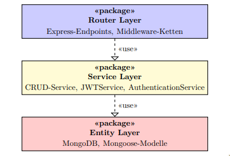

# no-model-dependencies

Stellt sicher, dass keine Mongoose-Funktionen innerhalb der Express-Router verwendet werden.

## Regel Details

Diese Regel überprüft, dass `Prof`, `Gebiet` und `Thema` Entitäten nicht innerhalb von Express-Router verwendet werden. Stattdessen soll die bereits implementierte Geschäftslogik der `services` verwendet werden um die Drei-Schichtenarchitektur einzuhalten.

## Warum ist diese Regel wichtig?

### Problem 1: Unbeabsichtigte Rückgabe von Passwörtern
Gerade bei `Prof` ist die ungefilterte Rückgabe des Dokuments an den Client extrem gefährlich. Hierbei können unbeabsichtigt Passwörter mitgegeben werden, da Mongoose-Queries in der Regel jeden Bestandteil der Entität zurückliefern.

### Problem 2: Don't Repeat Yourself
Das Verwenden von Mongoose-Funktionen innerhalb der Router sorgt für redundanten Code.
In bereits vergangenen Arbeitsblättern wurden die `services` implementiert und finden in den Express-Routen ihren Einsatz.

## Beispiele

### Falsche Implementationen

```javascript
import { Prof } from "../model/ProfModel";

app.get('/alle', async (req, res) => {
    const profs = await Prof.find({}).exec();
    res.send(profs); // <-- Extrem gefährlich! Hier ist das Passwort mitenthalten!
});
```

### Korrekte Implementationen

```javascript
// import { Prof } from "../model/ProfModel"; // <-- Hat nichts in den Routern verloren!
import { getAlleProfs } from "../services/ProfService"

app.get('/alle', async (req, res) => {
    // const profs = await Prof.find({}).exec(); // <-- Auf keinen Fall!
    const profs = await getAlleProfs(); // <-- DRY. Work smart, not hard!
    res.send(profs);
});
```

## Best Practices

### 1. Entfernen von `model`-Imports innerhalb der Express-Router

Um relativ schnell Architekturverstöße zu identifizieren kann man in VSCode den Tastenkürzel `Strg + F` oder `Cmd + F` in einer geöffneten Datei verwenden um nach `model`-Imports zu suchen.
Es empfiehlt sich diese ausnahmslos in jedem Router zu entfernen, da dann TypeScript-Kompilierungsfehler entstehen sofern sie innerhalb der Router verwendet werden. Diese können dann ganz einfach mit der jeweiligen `services`-Funktion (bspw. `createProf` statt `Prof.create`) ersetzt werden.

### 2. Vertraut machen mit der Drei-Schichtenarchitektur

Mach dich vertraut mit der Schichtenarchitektur, die in der Projektskizze erläutert wird. Es ist wichtig, dass du die Architektur verstehst und ihre Vorteile verinnerlichst: Es dürfen auf keinen Fall Zwischenschichten umgangen werden bei der Implementierung, da dies im schlimmsten Fall schwere Sicherheitsrisiken mitbringen. Nicht nur kannst du versehentlich Passwörter an den Client schicken sondern können auch berechnete Werte (wie `anzahlThemen` oder `verwalterName`) in der Response fehlen. 

Das Paketdiagramm unten soll dir nochmal helfen die Schichten zu unterscheiden:  



<!-- ## Autofix

Diese Regel bietet einen automatischen Fix für **irgendwas**. Wenn ESLint im `--fix` Modus läuft, wird automatisch ein `irgendwas` gemacht.

```javascript
// Vorher
function foo() {
    "foo"; // Vergessenes 'return'
}

// Nach Autofix
function foo() {
    return "foo"; // 'return' eingesetzt
}
```

**Hinweis:** Der Autofix fügt das `return` ein, entfernt aber keinen unerreichbaren Code. Du solltest den Code nach dem Fix manuell überprüfen und aufräumen. -->

<!-- ## Optionen

Diese Regel hat keine Optionen. -->

<!-- TODO ## Weiterführende Ressourcen -->

## Version

Diese Regel wurde in Version 1.0.0 eingeführt.